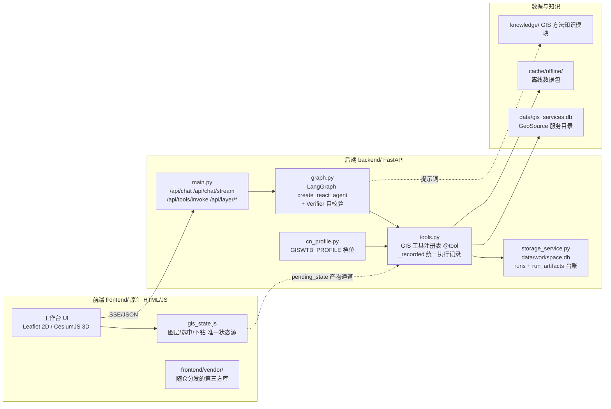

<p align="center">
  
</p>

# GIS WorkTable-CN

结合自然语言 AI Agent 与手动工具的开源 GIS 工作台，用于空间数据处理、空间分析及 2D/3D 地图可视化。

[](LICENSE)
[](backend/requirements.txt)

[项目背景](#一项目背景) · [技术架构](#二技术架构) · [应用场景](#三应用场景) · [**创新点**](#四创新点与技术差异化) · [快速开始](#五快速开始) · [功能一览](#六功能一览与工作台预览) · [部署配置](#七数据源与部署环境配置) · [协议与依赖](#八开源协议与第三方依赖合规) · [维护者与路线图](#九维护者与路线图) · [文档索引](#十一文档索引)

---

## 项目简介

GIS WorkTable-CN 把「找数据 → 空间分析 → 地图核验 → 导出成果」收进同一个工作台，并提供两条入口：**用自然语言让 AI Agent 编排工具**，或**用手动面板逐项配置**。两条入口复用同一套 GIS 工具注册表与产物通道，不存在"演示版"与"工具版"两套实现。

分析过程中，图层、属性与处理历史始终可见可查；2D（Leaflet）与 3D（CesiumJS）共享同一份图层状态，切换视图不丢上下文。结果可导出为 Shapefile / GeoJSON，交给 QGIS 或 ArcGIS 继续处理。

工程不依赖云端构建，前端为原生 HTML/CSS/JS，第三方库随仓库分发，**离线或内网环境可直接启动**；数据源与服务地址可按需配置（见[第七节](#七数据源与部署环境配置)）。

界面采用黑白灰布局：顶部菜单、左侧首页 / 数据 / 图层 / 处理 / AI 导航、中央地图及底部工具条。首次访问默认打开首页面板，提供上手指引与一键运行样例；后续自动记忆上次打开的面板与收起状态。AI 助手默认收起，各侧面板可关闭、重新打开，并通过与地图之间的分隔条调整宽度。

---

## 一、项目背景

本项目针对现有 GIS 工具链的三个真实痛点立项，逐一对应解决：

| 痛点 | 具体表现 | 本项目的解法 |
| --- | --- | --- |
| **国内数据源适配难** | 主流桌面 GIS（QGIS / ArcGIS）面向全球通用数据设计，接入高德、百度等国内地图服务与国内坐标系（GCJ-02 等）往往需要额外插件或手工配置，底图与行政边界还常不符合国内表达规范 | 内置国内数据源与坐标系适配：高德 / 天地图 / DataV 即接即用，GCJ-02 坐标纠偏，边界注记符合国家标准 |
| **数据获取繁琐耗时** | 空间数据的检索、下载、预处理分散在不同平台、账号与格式之间，流程长、步骤碎；"找数据 → 处理 → 出图"对初学者门槛高 | 自然语言任务编排：一句话完成数据检索、下载、分析与可视化，底层复用同一套 GIS 工具注册表 |
| **专业软件重、门槛高** | 桌面专业软件体积大、安装配置重、许可成本高；轻量场景、临时演示、教学机房代价过大 | 浏览器端即开即用：前端原生 HTML/JS + 本地后端，零安装、可离线、MIT 完全开源 |

---

## 二、技术架构

### 架构图



### 关键机制

- **前端单一状态源**：`frontend/js/gis_state.js` 统一管理图层、选中要素与下钻栈，2D / 3D 与 UI 面板订阅同一状态，保证两个视图一致。
- **Agent 执行链路**：`backend/main.py` 的 `/api/chat/stream` → `graph.py:run_agent_stream()` → LangGraph `create_react_agent` 自动路由到 `tools.py` 中被 `_recorded()` 包装的注册工具 → 产物写入 `pending_state` → Verifier 自校验与 `result_guard` 三方核对（声明的产物 ↔ 工具注册表 ↔ 磁盘文件）→ `storage_service` 落台账。
- **执行台账**：`data/workspace.db` 记录每次 run 与产物关联；产物存相对路径，迁移目录后可自愈解析；基于 `run_id` 的单次执行隔离防止历史同名文件造成"未执行却报成功"。
- **重活不阻塞事件循环**：工程加载 / 保存、Shapefile 导出、逆地理编码等同步重活统一经 `asyncio.to_thread` 移出事件循环；状态锁使用 `RLock`，避免 `reset_registered_layers` 持锁内调用 `_register_layer` 造成自死锁。

### 目录结构

```text
backend/       FastAPI 入口、Agent、GIS 工具、数据连接器、pytest 测试
frontend/      原生 HTML/CSS/JS、Leaflet 与 CesiumJS（无构建步骤）
desktop/       Electron 桌面外壳（实验性）
knowledge/     GIS 方法与知识模块
skills/        项目内 GIS 领域提示文档（不是 Codex skill 安装目录）
data/          GeoSource SQLite 数据库快照
docs/          功能、架构、协作规范与发布文档
```

详见 [架构与模块](docs/architecture.md)。

---

## 三、应用场景

| 目标用户 | 应用场景 | 在本项目中的落地方式 |
| --- | --- | --- |
| **GIS 本科生 / 研究生** | 课程作业、毕业设计中的空间分析原型验证 | 用自然语言完成分析，无需先记住面板路径；结果与属性可直接目检 |
| **教学与演示现场** | 机房、会场等网络受限环境 | 前端依赖随仓分发 + 离线数据包，断网可启动 |
| **空间数据工作者** | 快速检索数据目录、批量缓冲 / 叠置、结果交给 QGIS / ArcGIS 继续处理 | GeoSource 服务目录检索；结果导出 Shapefile / GeoJSON |
| **规划与应急原型** | 选址缓冲、服务区与可达性、热点识别、遥感指数初筛 | 缓冲 / 叠置 / 网络分析 / 热点分析 / 遥感指数工具链 |
| **遥感与地形初筛** | DEM 地形分析、NDVI 等指数快速核查 | GeoTIFF 上传或在线高程获取；栅格与空间统计工具 |

---

## 四、创新点与技术差异化

| 创新点 | 解决的问题 | 实现与验证 |
| --- | --- | --- |
| **手动与 AI 复用同一工具注册表与产物通道** | 消除"演示版"与"工具版"两套实现的不一致 | `tools.py` 单一注册表，`/api/tools/invoke` 与聊天链路调用同一函数；Layer 3/4/5 集成测试覆盖 |
| **产物三方核对（Claim ↔ Registry ↔ Filesystem）+ `run_id` 隔离** | 杜绝"AI 未真实执行却报成功"的假阳性 | `storage_service.py` + `result_guard.py` 核对声明产物、工具注册表与磁盘文件；安全测试覆盖 |
| **执行台账 + 相对路径自愈** | 更换磁盘或移动项目目录后，历史分析轨迹仍可解析 | `data/workspace.db` 的 `runs` / `run_artifacts` 表统一落账 |
| **五层分层测试体系** | 改动后能分层验证，测试不与 GIS 主系统割裂 | 单元 / Agent 决策 / GIS 工具集成 / 地图图层通道 / E2E；`scripts/run_layered_tests.py`，`backend/tests/` 565 个测试函数 |
| **前端依赖随仓分发** | 网络受限环境下无法加载 CDN 资源 | `frontend/vendor/` 内置 Leaflet / CesiumJS / ECharts 等，零 CDN 引用 |
| **部署档位 `GISWTB_PROFILE`** | 不同网络条件下数据源可用性不一致 | `backend/services/cn_profile.py` 按档位注册可用数据源 |
| **底图与注记数据源白名单** | 行政边界与地图注记需符合国家地图表达规范 | 2D `frontend/js/map.js`、3D `frontend/js/renderer_cesium.js` |
| **地名解析与坐标纠偏** | GCJ-02 与 WGS-84 混用造成数百米级偏移 | `datav_boundary` 工具；Layer 3 测试覆盖南京市鼓楼区案例 |
| **离线数据包预热** | 断网环境下需要可用的基础地理数据 | `scripts/prefetch_offline.py` 预热省级行政边界缓存 |

### 与同类方案的差异

| 维度 | 传统桌面 GIS（QGIS / ArcGIS 类） | 通用 LLM + 代码沙箱 | 本项目 |
| --- | --- | --- | --- |
| 分析入口 | 手动面板为主，需逐项配置 | 自然语言，但工具能力依赖临时生成代码 | 自然语言与手动面板复用同一 GIS 工具注册表 |
| 结果可核查 | 依赖人眼核对 | 依赖模型自述，产物缺少独立核对 | 声明 / 注册表 / 磁盘三方核对 + `run_id` 隔离 |
| 网络受限环境 | 本地为主，在线插件多依赖外部服务 | 多依赖外部 CDN 与 API | 前端依赖随仓分发 + 本地缓存 + 离线数据包 |
| 部署与协议 | 商业许可或 GPL 系 | 视实现而定 | MIT，依赖与数据源合规声明明确（见第八节） |

---

## 五、快速开始

### 环境要求

- **已实测环境：Windows 11 + Python 3.13**（macOS / Linux 尚未实测，见[已知限制](#十已知限制)）。
- Python 3.11+，建议使用独立虚拟环境；依赖包含地理计算库。
- 现代浏览器；前端无需 Node.js 构建。
- 桌面版额外需要 Node.js / npm 和 Electron 依赖。
- 使用 AI 时需要模型服务配置；**手动本地分析可先不配置模型（零 API Key 即可跑通）**。

### 安装与启动

在仓库根目录执行：

```bash
git clone https://github.com/Wukeeeeee/GIS-WORKTABLE-CN.git
cd GIS-WORKTABLE-CN
python -m venv .venv
```

Windows PowerShell 激活环境：

```powershell
.\.venv\Scripts\Activate.ps1
```

macOS / Linux 激活环境：

```bash
source .venv/bin/activate
```

安装依赖并启动 Web 版：

```bash
python -m pip install -r backend/requirements.txt
python -m uvicorn backend.main:app --host 127.0.0.1 --port 8010
```

浏览器打开 <http://127.0.0.1:8010>。开发时可在启动命令末尾添加 `--reload`。

Windows 可运行 `start.bat`（Web 版）或 `scripts/start-desktop.bat`（桌面版）。启动器只复用当前仓库的 GIS 服务，默认端口 **8010**，端口冲突时报错而不自动切换，以保持浏览器本地存储地址稳定；可用环境变量 `GIS_PORT` 手动指定其他端口。`scripts/stop.bat` 只停止默认端口（或 `GIS_PORT` 指定端口上）身份匹配的服务。

Python 解释器依次选择 `GIS_PYTHON`、项目 `.venv`、PATH 中的 Python。

### 第一次操作

1. 在地图上绘制一个面，或导入自己的 GeoJSON 文件。
2. 在图层面板选中该图层，打开手动空间分析面板。
3. 选择缓冲区，设置距离与单位并执行。
4. 检查结果图层、属性和处理历史，再导出结果。

使用 AI 时，可针对已加载图层输入：`对图层名为 polygons 的图层做 500 米缓冲区`。图层名应与实际加载的名称一致。

### 配置

- **模型服务**：设置 → AI 模型，填写 Provider、Base URL、模型名和 API Key。配置保存在浏览器 localStorage；调用 AI 时，密钥随请求发送到本地后端，由后端访问所选模型服务。
- **数据源与底图**：按需在连接器中配置账号或密钥；行政边界与底图默认使用可直连的国内服务，无需为本地手动分析配置全部数据源。
- **GeoSource**：默认使用 `data/gis_services.db`；也可能优先读取更新时间更晚的同级 `GeoSource/gis_services.db`。可通过环境变量 `GEOSOURCE_DB_PATH` 指定已有数据库文件。目录条目不代表服务始终可用。关联项目见 [GeoSource-MCP](https://github.com/Wukeeeeee/GeoSource-MCP.git)。
- **本地状态**：会话、任务和处理历史位于 `cache/`，生成产物位于 `output/`；清理前请保存需要保留的工程和结果。

### 运行测试

统一入口：

```bash
# 快速模式：Layer 1（单元）+ Layer 2（Agent 决策）
python scripts/run_layered_tests.py --mode fast

# 集成模式：Layer 3（GIS 工具）+ Layer 4（地图图层通道）
python scripts/run_layered_tests.py --mode integration

# 全量回归：Layer 1~5 全链路（合并前执行）
python scripts/run_layered_tests.py --mode regression
```

也可在仓库根目录直接运行 `python -m pytest backend/tests/ -q`。部分测试依赖外部网络或服务，跳过与失败原因按实际输出记录。

---

## 六、功能一览与工作台预览

| 能力 | 内容 | 使用条件 |
| --- | --- | --- |
| 手动 GIS 操作 | 图层管理、绘制、测量、缓冲、叠置、符号化、属性编辑、处理历史与重跑 | 本地分析无需模型 API Key |
| AI Agent | 自然语言任务规划、多轮实体继承、行动优先（免问卷式过度追问）、单区指标看板与多区分级设色自适应、未执行代码推脱拦截 | 配置兼容 OpenAI 接口的模型服务（DeepSeek、GLM、Agnes 等） |
| 2D / 3D 地图 | Leaflet / CesiumJS 共享图层状态，行政区下钻、面要素拉伸展示，轻量全局 Toast 操作反馈 | 底图和在线边界服务需要网络 |
| 栅格与空间统计 | 地形分析、遥感指数、插值、自相关、热点与网络分析 | 对应输入数据；部分工具需要在线数据 |
| 数据接入 | 文件导入、GeoSource 目录检索、OGC / ArcGIS 服务、云原生格式 | 数据库快照、服务可用性及授权因来源而异 |
| 工程与互通 | 工程保存与恢复（`.giswork`）、图层导出（Shapefile / GeoJSON，兼容 QGIS 与 ArcGIS）、地图及报告导出、DAG 工作流、stdio MCP Server | MCP 接入见 [docs/mcp_server.md](docs/mcp_server.md) |


上图使用内置矩形和点样例。地图点要素使用与图层颜色一致的实心圆点和细白边，便于在卫星影像上辨认；界面 Logo 和工具图标使用 PNG / CSS，地图矢量使用 Canvas。空间分析、统计和栅格等工具窗口可通过右下角拖动调整宽高，支持折叠和关闭。

---

## 七、数据源与部署环境配置

为适应不同网络条件，数据源按部署档位注册，并保留完整的降级链路。

| 能力 | 说明 |
| --- | --- |
| **前端依赖随仓分发** | Leaflet / Marked / Draw / Heat / VectorGrid / Cesium 等全部内置于 `frontend/vendor/`，无 CDN 引用，离线或内网可正常启动 |
| **底图与注记白名单** | 默认使用可直连的卫星影像底图（免 Key）；配置天地图 tk（凭据管理 → 天地图）后可切换官方中文注记底图（CGCS2000，与 WGS-84 数据直接叠加无偏移）。行政边界与地图注记采用符合国家标准的官方数据 |
| **数据源准入** | 按档位注册可用数据源。行政边界、地名检索等默认走国内可直连服务（如 DataV 行政边界，含 GCJ-02 → WGS-84 纠偏）；离线档位仅启用本地离线包 |
| **离线数据包** | `python scripts/prefetch_offline.py` 预热全国 34 个省级行政边界缓存（可选 `--with-cities` 预热全部地级市）；DEM / 路网 / 影像子集按 AOI 预下载至 `cache/offline/` |
| **降级链路** | 远程源直连 → 本地缓存 → 离线数据包 → 明确中文报错；AI 提示词层同步约束：数据源不可用时如实告知、禁止编造 |

### 部署档位（`GISWTB_PROFILE`）

| 取值 | 行为 |
| --- | --- |
| `cn`（默认） | 优先使用国内可直连服务；在线数据工具失败时自动降级到本地缓存 |
| `competition` | 演示 / 离线模式：仅启用本地离线包与已缓存数据 |
| `intl` | 启用全部在线数据源 |

---

## 八、开源协议与第三方依赖合规

### 本项目协议

- 本项目源码采用 **[MIT License](LICENSE)**（Copyright © 2026 Wukeeeeee）。
- 完整依赖清单见 [`backend/requirements.txt`](backend/requirements.txt)（含版本约束与"勿删"说明，例如 `openai` 为 `langchain-openai` 的传递依赖、`langgraph` 限定 1.x）。
- 前端第三方库内置于 [`frontend/vendor/`](frontend/vendor/)，保留各自许可证与版权声明，本项目未修改其源码。

### 主要依赖及许可证索引

以下为上游项目公开声明，最终以各项目仓库 `LICENSE` 为准。

| 依赖 | 许可证 | 用途 |
| --- | --- | --- |
| FastAPI | MIT | Web API 框架 |
| uvicorn | BSD-3-Clause | ASGI 服务器 |
| LangGraph / LangChain / langchain-core / langchain-openai | MIT | Agent 编排 |
| MCP | MIT | 对外暴露 GIS 工具给外部 AI 客户端 |
| Shapely / GeoPandas | BSD-3-Clause | 几何与矢量数据处理 |
| NumPy / pandas / SciPy / scikit-learn / scikit-image | BSD-3-Clause | 数值与统计计算 |
| Rasterio | BSD-3-Clause | 栅格读写 |
| PyProj / pyogrio | MIT | 坐标变换与矢量 IO |
| NetworkX | BSD-3-Clause | 网络分析 |
| Requests | Apache-2.0 | HTTP 客户端 |
| Playwright | Apache-2.0 | 端到端测试 |
| Pillow | HPND | 图像处理 |
| Matplotlib | Matplotlib (PSF-based) | 制图 |
| pmtiles / mapbox-vector-tile | BSD-3-Clause | 云原生格式流式加载 |
| pyecharts / markdownify / adjustText | MIT | 图表与文本转换 |
| orjson | Apache-2.0 / MIT 双许可 | 高性能 JSON |
| scrapling | 以仓库声明为准 | 网页抓取 |

### 第三方数据与底图

- 底图与影像（高德、天地图等）、行政边界（DataV 等）、服务目录（GeoSource）等第三方数据的版权归各自权利方，**不在 MIT 许可范围内**；使用和分发需遵守其来源条款。
- 行政边界与地图注记采用符合国家标准的官方数据，符合国家地图表达规范。

---

## 九、维护者与路线图

| 项目 | 现状 |
| --- | --- |
| 维护者 | [@Wukeeeeee](https://github.com/Wukeeeeee)（项目作者），GIS 领域开源工具 |
| 社区入口 | Issue 与 PR 见 [GitHub Issues](https://github.com/Wukeeeeee/GIS-WORKTABLE-CN/issues)；规范要求见 [CONTRIBUTING.md](CONTRIBUTING.md)、[命名与描述规范](docs/repository-standards.md) |
| 版本与发布 | [CHANGELOG.md](CHANGELOG.md) 记录变更，[发布流程](docs/release-guide.md) 规定版本与验证证据 |

### 路线图

1. 桌面客户端（Electron 外壳）补齐 macOS / Linux 启停脚本与实测。
2. 面向多用户的部署形态：身份认证、工具执行权限与数据隔离。
3. 离线包覆盖面扩展，并为部署档位补充自动化回归测试。
4. 引入 Issue / PR 模板与贡献者名单，逐步过渡到多人协作。

详细路线图见 [docs/ROADMAP.md](docs/ROADMAP.md)。

---

## 十、已知限制

- 本项目仅在 **Windows 11 + Python 3.13** 完成实测；macOS / Linux 尚未实测，随仓脚本 `start.bat` / `scripts/stop.bat` 仅适用于 Windows，其他平台请按上文的 `uvicorn` 命令启动。
- 桌面客户端仅完成 Windows 人工验证；手动安装命令尚未在全新环境完整验证。
- 结果真实性检查核对已知文件与图层产物，不能证明分析方法或 AI 解读一定正确。
- 卫星影像巡检采用 RGB 启发式初筛，不等同于专业遥感分类。
- DEM 可上传 GeoTIFF，也可通过高程工具获取在线地形数据；在线获取受数据覆盖和网络影响。主地图 3D 视图与工具生成的地形预览是不同能力，不应混为一谈。
- 遥感平台下载、POI、底图、行政边界等在线数据受账号、接口、配额与第三方服务条款约束；超大数据和路网任务可能耗时较长。
- 云原生加载中的预览、抽样或范围过滤可能只展示部分数据，需核对工具输出说明。
- 当前默认启动方式面向本机使用；公开部署前需要单独评估身份认证、工具执行权限及数据隔离。

GIS 结果仅供研究和辅助分析，不替代专业判断。软件许可证不授予第三方底图、影像或数据的额外使用权；使用和分发这些数据时应遵守来源条款。

---

## 十一、文档索引

**架构与设计**

- [架构与模块](docs/architecture.md) · [设计说明](DESIGN.md) · [功能说明](docs/features.md)
- [MCP Server 配置](docs/mcp_server.md) · [手动直连工具设计说明](docs/summary_manual_direct_tools.md)
- [3D 地球与下钻调研](docs/research_3d_globe_drilldown.md) · [AI 对话与工具延迟检查](docs/performance-audit.md)

**开发与协作**

- [分层测试指南](docs/layered-testing-guide.md) · [工具验证记录](docs/tool-validation.md)
- [贡献指南](CONTRIBUTING.md) · [命名与描述规范](docs/repository-standards.md)
- [界面与面板规范](docs/ui-guidelines.md) · [更新日志](CHANGELOG.md) · [发布流程](docs/release-guide.md)

**规划与评估**

- [项目路线图](docs/ROADMAP.md) · [仓库盘点与方向评估](docs/repository-audit.md) · [项目审计](docs/PROJECT_AUDIT.md)

问题与建议请提交 [Issue](https://github.com/Wukeeeeee/GIS-WORKTABLE-CN/issues)，尽量附最小复现数据。

---

## 许可证与致谢

项目源码采用 [MIT License](LICENSE)。Leaflet、CesiumJS、FastAPI、LangGraph、GeoPandas、Shapely、Rasterio 等依赖及第三方数据仍适用各自许可证和使用条款（见第八节）。

卫星影像巡检的算法思路参考 [GeoHarness](https://github.com/Star-Learning/GeoHarness)；空间服务目录关联项目为 [GeoSource-MCP](https://github.com/Wukeeeeee/GeoSource-MCP.git)。
