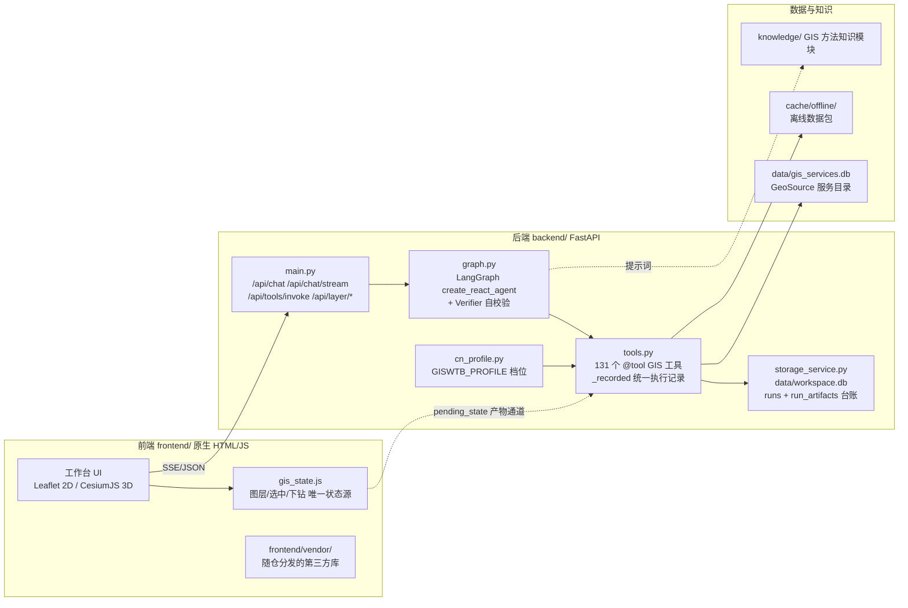

# GIS WorkTable-CN 作品介绍

> 参赛文档源文件（Markdown）。导出 PDF 时建议按本文件章节顺序排版，目标 8–12 页。
> 所有数字与功能描述均以 2026-10-13 的仓库实际代码与测试结果为准。

---

## 1. 项目名称与定位

**GIS WorkTable-CN** 是一个结合自然语言 AI Agent 与手动操作面板的开源 GIS 工作台，用于空间数据处理、空间分析及 2D/3D 地图可视化。

项目采用双仓结构：主仓承载通用能力演进，本仓（CN）承载面向国内部署环境的配置与优化，两仓定期同步。本仓的额外重点是让工具链在**离线或网络受限环境**下依然完整可用，并使行政边界与地图注记符合国家地图表达规范。

**一句话定位**：让用户用一句话完成"找数据 → 空间分析 → 地图核验 → 导出成果"，并且在离线、内网、比赛现场环境下依然可用。

## 2. 项目背景与要解决的问题

现有 GIS 工作流存在三个断点：

1. **操作门槛**：缓冲区、叠置、插值等分析需要逐面板配置，学习成本高；初学者更习惯自然语言表达需求。
2. **AI 结果不可核查**：直接把 LLM 接入 GIS 工具后，"AI 说它做了"不等于"文件真的生成了"。多轮对话中历史同名文件还会造成假阳性误判。
3. **部署环境不可控**：大量 GIS 工具依赖外部 CDN、在线底图与远程数据源，教学机房、比赛现场、内网环境下一旦断网，整条工具链就停摆。

本项目分别对应三个解法：自然语言任务编排（Agent 组合 GIS 工具）、产物三方核对机制（Claim ↔ Registry ↔ Filesystem）、以及可配置的部署档位（profile）配合随仓分发的前端依赖、本地缓存与离线数据包。

## 3. 目标用户与应用场景

| 用户 | 场景 |
| --- | --- |
| GIS 本科生/研究生 | 课程作业、毕业设计中的空间分析原型验证；不用背面板也能完成分析 |
| 教学与比赛 | 网络受限的机房/赛场演示，离线即可运行 |
| 空间数据工作者 | 快速检索数据目录（GeoSource）、批量缓冲/叠置、结果导出为 Shapefile/GeoJSON 供 QGIS/ArcGIS 后续使用 |

## 4. 核心功能与典型使用流程

### 4.1 功能总览

| 能力 | 说明 |
| --- | --- |
| 手动 GIS 操作 | 图层管理、绘制、测量、缓冲、叠置、符号化、属性编辑、处理历史与重跑（本地分析无需模型 API Key） |
| AI Agent | 自然语言任务规划、多轮实体继承、行动优先（免问卷式追问）、指标看板与分级设色自适应、未执行代码推脱拦截 |
| 2D/3D 地图 | Leaflet / CesiumJS 共享图层状态，行政区下钻、面要素拉伸 |
| 栅格与空间统计 | 地形分析、遥感指数、插值、自相关、热点与网络分析 |
| 数据接入 | 文件导入、GeoSource 服务目录（SQLite 快照）、OGC/ArcGIS 服务、云原生格式 |
| 工程与互通 | 工程保存/恢复（.giswork）、导出 Shapefile/GeoJSON、DAG 工作流、stdio MCP Server |

### 4.2 典型流程（AI 入口与手动入口复用同一工具层）

1. 导入 GeoJSON（或在地图绘制面要素）→ 图层进入统一注册表；
2. 自然语言："对图层 xxx 做 500 米缓冲区" → Agent 选择 `spatial_buffer` 工具并填参；
3. 工具执行 → 结果图层经统一产物通道挂载到地图，执行记录写入处理历史（可一键重跑）；
4. 用户在地图上目检结果、查看属性 → 导出 Shapefile/GeoJSON。

配套截图（图层面板 + 缓冲区结果 + 处理历史）见 [`docs/competition/screenshots.md`](screenshots.md)。

## 5. 系统技术架构

> 架构图源文件为本节 Mermaid 代码（可编辑），导出 PDF 时渲染为图。

**关键机制说明**（均有对应代码）：

- **前端单一状态源**：`frontend/js/gis_state.js` 统一管理图层、选中要素与下钻栈，2D/3D 与 UI 面板订阅同一状态，保证两个视图一致。
- **Agent 执行链路**：`backend/main.py` 的 `/api/chat/stream` → `graph.py:run_agent_stream()` → LangGraph `create_react_agent`（recursion_limit=120）自动路由到 `tools.py` 中被 `_recorded()` 包装的注册工具 → 产物写入 `pending_state` → Verifier 自校验 Agent 与 `result_guard` 三方核对（声明的产物 ↔ 工具注册表 ↔ 磁盘文件）→ `storage_service` 落台账。
- **执行台账**：`data/workspace.db` 记录每次 run 与产物关联，产物存相对路径，迁移目录后可自愈解析；基于 run_id 的单次执行隔离防止历史同名文件造成"未执行却报成功"。

## 6. AI Agent 与 GIS 工具的协作机制

1. **工具即接口**：131 个 GIS 工具以 `@tool` 装饰器注册（`backend/services/tools.py`），手动面板直连与 Agent 调用走同一函数，避免"演示版"与"工具版"两套实现。
2. **行动优先**：输入含 GIS 关键词或超长时直接进入工具链路，避免问卷式反问；简短闲聊走轻量分支直答。
3. **实体继承**：多轮对话中"对它做缓冲"的"它"由会话上下文解析（`set_conversation_context`），无需用户重复图层名。
4. **产物可信**：工具真实执行后才会注册图层/文件；Verifier 与 result_guard 核对三方一致性，AI 声称的输出必须在磁盘上存在才判成功。
5. **执行可追溯**：每轮 run、每次工具调用进入 SQLite 台账，处理历史支持重跑。

## 7. 技术创新点

| 创新点 | 解决的问题 | 实现与验证 |
| --- | --- | --- |
| 手动与 AI 复用同一工具注册表与产物通道 | 消除"演示版"与"工具版"两套实现 | `tools.py` 单一注册表，`/api/tools/invoke` 与聊天链路同函数；Layer 3/4/5 集成测试通过 |
| 产物三方核对（Claim ↔ Registry ↔ Filesystem）与 run_id 隔离 | 杜绝"AI 未真实执行却报成功"的假阳性 | `storage_service.py`、`result_guard.py`；安全测试与分层测试覆盖 |
| 五层分层测试体系 | 单元测试/Agent 决策/工具集成/地图通道/E2E 分层回归 | `scripts/run_layered_tests.py`；`backend/tests/` 565 个测试函数，2026-10-13 全量回归通过 |
| 前端依赖随仓分发 | 网络受限环境下无法加载 CDN 资源 | `frontend/vendor/` 内置 Leaflet/CesiumJS/ECharts 等，零 CDN 引用 |
| 执行台账与相对路径自愈 | 迁移目录后历史分析轨迹失效 | `data/workspace.db` runs/run_artifacts 表 |
| 部署档位 `GISWTB_PROFILE` | 不同网络条件下数据源可用性不一致 | `backend/services/cn_profile.py` 按档位注册可用数据源；演示档位仅启用本地离线包 |
| 底图与注记数据源白名单 | 行政边界与地图注记需符合国家地图表达规范 | 2D `map.js`、3D `renderer_cesium.js`；按标准地图目检 |
| 地名→边界解析与坐标纠偏 | GCJ-02 与 WGS-84 混用造成数百米级偏移 | `datav_boundary` 工具；Layer 3 测试覆盖南京市鼓楼区案例 |
| 离线数据包预热 | 断网环境下需要可用的基础地理数据 | `scripts/prefetch_offline.py` 预热行政边界缓存 |

### 未来规划

- 桌面客户端（Electron 外壳）走出实验性阶段，并补齐 macOS / Linux 的启停脚本与实测。
- 面向多用户的部署形态（身份认证、工具执行权限、数据隔离）。
- 离线包覆盖面扩展与部署档位的自动化回归测试。

### 与同类方案的差异

| 维度 | 传统桌面 GIS（QGIS / ArcGIS 类） | 通用 LLM + 代码沙箱 | 本项目 |
| --- | --- | --- | --- |
| 分析入口 | 手动面板为主 | 自然语言，工具能力依赖临时生成代码 | 两条入口复用同一 GIS 工具注册表 |
| 结果可核查 | 人眼核对 | 依赖模型自述，缺少独立核对 | 声明 / 注册表 / 磁盘三方核对 |
| 网络受限环境 | 在线插件依赖外部服务 | 依赖外部 CDN 与 API | 依赖随仓分发 + 本地缓存 + 离线包 |
| 协议与部署 | 商业许可或 GPL 系 | 视实现而定 | MIT，依赖与数据源合规声明明确 |

## 8. 数据源与部署环境配置

| 配置项 | 实现 |
| --- | --- |
| 前端依赖随仓分发 | Leaflet/Marked/Draw/Heat/VectorGrid/Cesium 全部内置 `frontend/vendor/`，无 CDN 引用 |
| 底图与注记白名单 | 默认使用可直连的卫星影像底图（免 Key）；配置天地图 tk 后可切换官方中文注记底图。行政边界与地图注记采用符合国家标准的官方数据 |
| 数据源准入 | 按部署档位注册可用数据源。行政边界、地名检索等默认走国内可直连服务（如 DataV 行政边界）；离线演示档位仅启用本地离线包 |
| 降级链路 | 远程源直连 → 本地缓存 → 离线数据包 → 明确中文报错；AI 提示词要求数据源不可用时如实告知、禁止编造 |

## 9. 工程实现、测试与已知限制

- **代码规模**：后端 FastAPI + LangGraph（`backend/`），前端原生 HTML/CSS/JS 无构建步骤（`frontend/`），Electron 桌面外壳（`desktop/`，实验性）。
- **测试**：`backend/tests/` 含 55 个测试文件、565 个测试函数（静态计数）；统一入口 `scripts/run_layered_tests.py --mode fast|integration|regression`。最近一次全量分层回归：**2026-10-13，全部通过**（环境：Windows 11，Python 3.13，详见 submission-checklist）。
- **已知限制**：本项目仅在 Windows 11 + Python 3.13 完成实测，macOS / Linux 尚未实测且随仓启动脚本仅适用于 Windows；桌面端仅 Windows 人工验证；在线数据工具受第三方服务配额约束；结果真实性检查只能核对产物存在性，不能证明分析结论正确。

## 10. 开源许可证、部署与规划

- **许可证**：MIT License（`LICENSE`）。Leaflet、CesiumJS、FastAPI、LangGraph、GeoPandas、Shapely、Rasterio 等依赖适用各自许可证；第三方底图/影像/数据的版权归原方，使用需遵守来源条款。
- **部署方式**：本地 Web（`python -m uvicorn backend.main:app --port 8010` 或 `start.bat`，默认端口 8010）；快速开始见 README「快速开始」章节。
- **仓库**：
  - CN 参赛仓库：https://github.com/Wukeeeeee/GIS-WORKTABLE-CN
  - 主仓：https://github.com/Wukeeeeee/GIS-WORKTABLE

## 11. 演示入口

- 演示视频链接：见提交材料清单 `docs/competition/submission-checklist.md`。
- 演示脚本与分镜：`docs/competition/demo-script.md`。
- 截图清单与采集步骤：`docs/competition/screenshots.md`。
